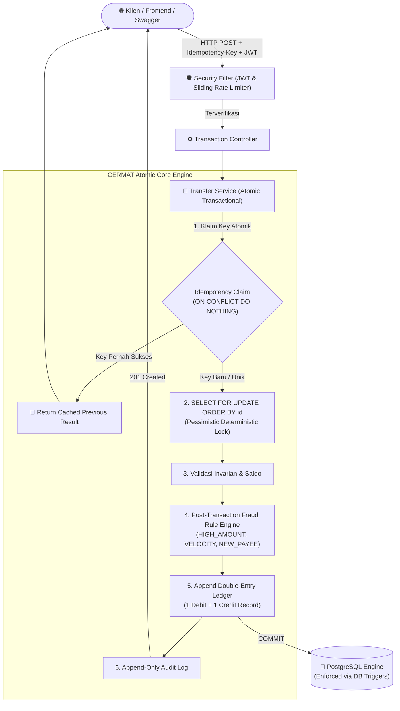
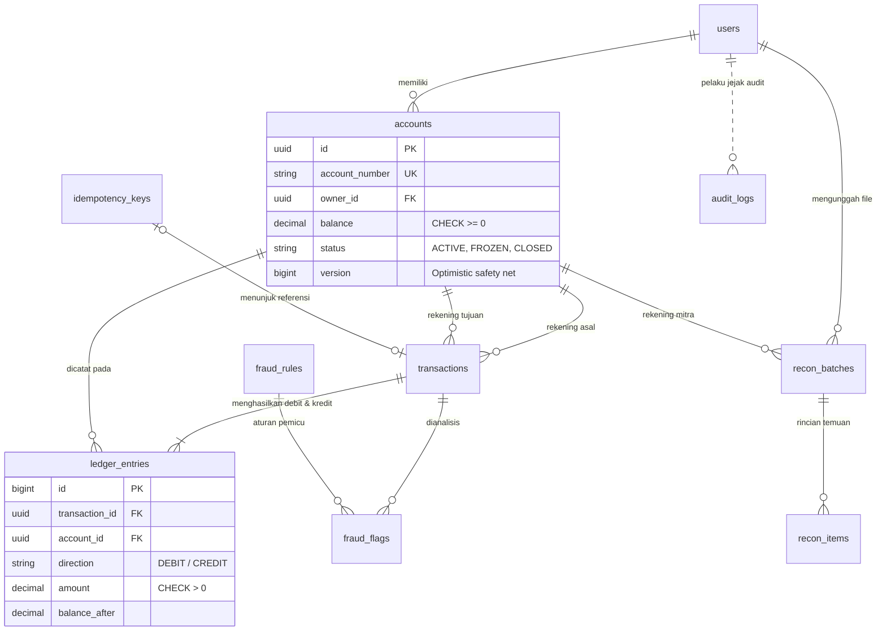
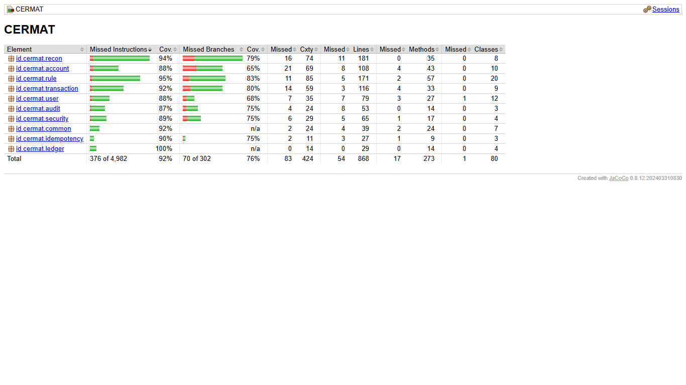
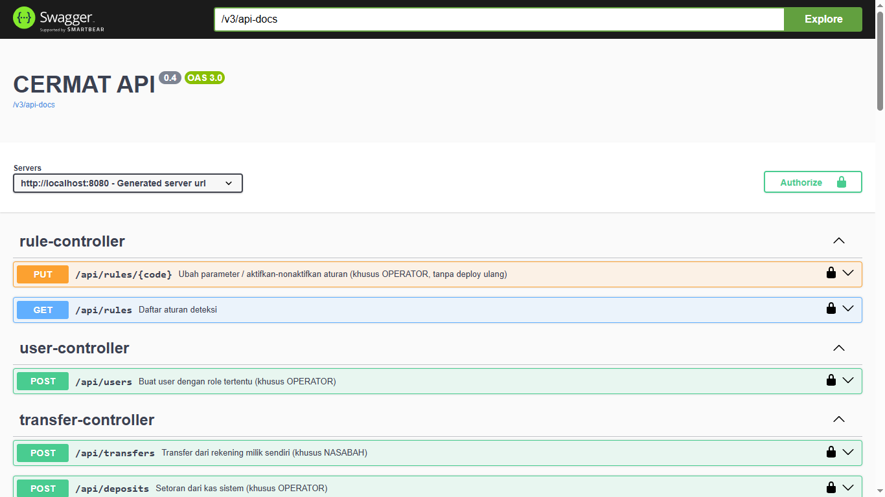
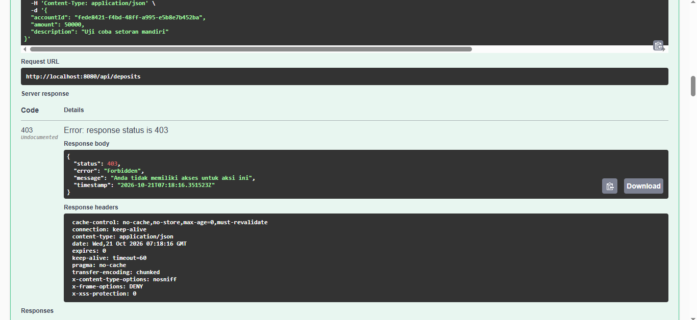

<div align="center">

# 🏦 CERMAT: Core-Banking Ledger Engine
### **C**atatan **E**lektronik, **R**ekonsiliasi, **M**utasi, **A**udit, & **T**ransaksi

> *"Setiap rupiah tercatat dengan presisi; tidak ada yang selisih, hilang, atau berlipat ganda."*

[](https://github.com/syubidin/cermat/actions/workflows/ci.yml)
[](https://openjdk.org/projects/jdk/17/)
[](https://spring.io/projects/spring-boot)
[](https://www.postgresql.org/)
[](https://flywaydb.org/)
[](#-pengujian--pembuktian-invarian)
[](#-pengujian--pembuktian-invarian)
[](#-menjalankan-aplikasi)
[](#-dokumentasi-api-interaktif-swagger-ui)
[](LICENSE)

<br/>

**CERMAT** adalah simulasi *mini core-banking ledger* & sistem pembayaran tingkat produksi (*production-grade financial engine*) yang dirancang khusus untuk memecahkan problem fundamental rekayasa finansial terdistribusi: **Race Condition, Double-Spending, Deadlock, Hot-Row Contention, dan Data Inconsistency**.

[Fitur Utama](#-fitur-utama--arsitektur-pertahanan) • [Arsitektur Sistem](#-arsitektur-sistem) • [Benchmark Performa](#-benchmark-skalabilitas-kas-sharding) • [Pengujian & Invarian](#-pengujian--pembuktian-invarian) • [Dokumentasi API](#-dokumentasi-api-interaktif-swagger-ui) • [Deployment](#-panduan-deployment-live-demo) • [Linimasa](#-linimasa-pengerjaan-8-minggu)

</div>

---

## 📌 Executive Summary (Untuk Recruiter & Engineering Lead)

Dalam sistem finansial skala besar, data uang tidak boleh sekadar disimpan di kolom `balance` biasa. Kerentanan jaringan, request berulang (*network retry*), dan lonjakan konkurensi sering kali memicu saldo negatif, transaksi siluman, atau kebocoran dana perusahaan. 

CERMAT mengimplementasikan standar industri perbankan:
1. **Zero Balance Anomaly Guarantee**: Menggunakan arsitektur *Double-Entry Bookkeeping* berbasis *append-only ledger* dengan trigger database level kernel untuk menjamin mutasi saldo tidak pernah bisa dimanipulasi atau dihapus (`UPDATE`/`DELETE` di-block permanen).
2. **Atomic Idempotency Engine**: Mengamankan transaksi via klaim atomik `INSERT ... ON CONFLICT DO NOTHING` dengan verifikasi SHA-256 payload untuk mencegah eksekusi ganda pada koneksi yang tidak stabil.
3. **Deadlock-Free Pessimistic Locking**: Mengunci rekening transaksi secara berurutan (`SELECT ... FOR UPDATE ORDER BY id`) membuktikan **nol deadlock** pada pengujian konkurensi dua arah intensif.
4. **Cash Sharding (+31% Throughput)**: Memecahkan bottleneck *hot-row lock contention* pada rekening kas utama ke dalam 16 balance shard dinamis.
5. **High Test Coverage (92%)**: Dilengkapi 104 skenario pengujian otomatis (Unit, Concurrency Stress Test, Security Hardening, dan API Integration).

---

## 🏛️ Arsitektur Sistem

Aliran data transaksi dari *client request* hingga tercatat pada ledger yang tidak dapat diubah (*immutable*):



### Model Data Relasional (ERD)



> [!NOTE]
> Jejak audit (`audit_logs`) sengaja tidak menggunakan *Foreign Key* ke tabel `users` agar integritas bukti audit tidak pernah terganggu atau terhapus jika entitas relasi mengalami perubahan.

---

## ⚡ Fitur Utama & Arsitektur Pertahanan

### 1. Double-Entry Bookkeeping & Append-Only Ledger
* Setiap perpindahan dana menghasilkan **tepat 2 entri jurnal**: 1 DEBIT pada rekening pengirim dan 1 KREDIT pada rekening penerima.
* Terproteksi *Database Trigger* PostgreSQL: perintah `UPDATE` atau `DELETE` pada tabel `ledger_entries` akan langsung dilemparkan sebagai exception oleh database kernel.
* Menggunakan tipe data `NUMERIC(19, 2)` (bukan `float`/`double`) untuk menjamin presisi matematis tanpa ada selisih fraksional pembulatan.

### 2. Idempotency Key Engine (Anti-Double Charge)
* Klien mengirimkan header HTTP `Idempotency-Key: <UUID>` pada setiap transaksi.
* Sistem melakukan klaim atomik via skema `INSERT INTO idempotency_keys ... ON CONFLICT DO NOTHING`.
* Jika terjadi *network drop* dan klien mengirim ulang request, transaksi **tidak akan diproses ulang**; sistem langsung menyajikan respons transaksi awal yang tersimpan.

### 3. Concurrency Control & Deadlock Prevention
* Menggunakan **Pessimistic Write Lock** (`SELECT ... FOR UPDATE`).
* Untuk mencegah *deadlock* saat User A mentransfer ke User B bersamaan dengan User B mentransfer ke User A, penguncian baris akun selalu disortir berdasarkan UUID/ID rekening (`ORDER BY id`).

### 4. High-Throughput Cash Sharding (Mitigasi Hot-Row)
* Pada saat ratusan pengguna melakukan setoran (deposit) likuiditas, rekening `KAS-SISTEM` berisiko mengalami antrean kunci baris (*hot-row lock contention*).
* CERMAT memecah kas sistem menjadi **16 shard independen** yang dipilih berdasarkan hashing atomik idempotency key.

### 5. Dynamic Fraud Detection & Account Freeze
* Modul pemantauan pasca-transaksi (*Post-Transaction Monitoring*) dengan aturan runtime:
  - `HIGH_AMOUNT`: Transaksi melebihi batas nominal tertentu.
  - `VELOCITY`: Frekuensi transaksi melebihi ambang batas per jendela waktu.
  - `NEW_PAYEE_BIG`: Transfer ke rekening baru pertama kali dengan nominal besar.
* Parameter aturan dapat diubah oleh peran `OPERATOR` secara dinamis tanpa perlu deploy ulang aplikasi. Akun yang mencurigakan dapat dibekukan secara instan (`FROZEN`).

### 6. Automated CSV Reconciliation Engine
* Fitur rekonsiliasi berkas mutasi bank mitra (parsing via Apache Commons CSV).
* Mendeteksi 4 status pencocokan secara otomatis: **MATCH**, **AMOUNT_MISMATCH**, **MISSING_IN_INTERNAL**, dan **MISSING_IN_PARTNER**.
* **Proteksi Keamanan CSV**:
  - *Anti Formula Injection*: Whitelist ketat karakter alphanumeric pada kolom `reference_no` dan `amount`. Karakter berbahaya seperti `=`, `+`, `-`, `@` ditolak langsung.
  - *Anti Duplikasi*: Hash berkas SHA-256 diverifikasi untuk mencegah pengunggahan file rekonsiliasi yang sama berulang kali.

### 7. Zero-Trust Security & RBAC
* Otentikasi Stateless berbasis **JWT (HS256)** dengan verifikasi masa berlaku (`exp`) dan `issuer`.
* Kontrol hak akses 3 Role:
  - `NASABAH`: Pembukaan rekening mandiri, cek saldo, mutasi, dan transfer.
  - `OPERATOR`: Manajemen fraud flag, pembekuan/pencairan rekening nasabah, dan rekonsiliasi CSV.
  - `AUDITOR`: Akses hanya-baca (*read-only*) ke seluruh jejak audit sistem.
* **Mitigasi OWASP API Security**:
  - Proteksi BOLA/IDOR: Nasabah yang mencoba mengakses rekening orang lain akan menerima respons `404 Not Found` (mencegah enumerasi ID).
  - Proteksi Mass Assignment: Pendaftaran akun baru menolak injeksi parameter `role`.
  - Rate Limiter Sliding Window: Pembatasan percobaan login pada layer memori sebelum eksekusi fungsi hashing CPU-intensive (BCrypt).

---

## 📊 Benchmark Skalabilitas: Kas Sharding

Pengujian beban setoran likuiditas (*stress test*) dengan **400 request bersamaan** melalui **10 worker thread**:

| Konfigurasi Kas | Waktu Eksekusi | Throughput (Req/detik) | Rata-Rata Latensi | Latensi p95 |
|:---|:---:|:---:|:---:|:---:|
| **1 Shard (Tunggal)** | 3.029 ms | 132,1 req/detik | 73,6 ms | 222 ms |
| **16 Shard (Terdistribusi)** | **2.314 ms** | **172,9 req/detik** | **49,0 ms** | 232 ms |
| **Peningkatan** | ⚡ **-23,6% Lebih Cepat** | 🚀 **+30,9% Throughput** | 📉 **-33,4% Latensi** | *Resource Bound* |

> [!TIP]
> **Analisis Rekayasa:** Penggunaan 16 shard berhasil menurunkan *lock queue time* secara signifikan pada antrean database. Latensi ekor (*p95*) tetap berada pada kisaran ~230 ms karena limitasi I/O disk dan CPU pada single-node machine pengujian, membuktikan bahwa eliminasi lock contention memberikan ruang throughput yang jauh lebih besar.

---

## 🧪 Pengujian & Pembuktian Invarian

Sistem ini dibangun dengan pendekatan *test-driven hardening*. Seluruh logika keuangan diuji secara komprehensif:

```bash
# Menjalankan seluruh rangkaian pengujian
./mvnw clean test
```

### Bukti Invarian Matematika & Konkurensi
- ✅ **150 Transfer Konkuren Bersamaan**: 150 thread mengirim transfer dari akun yang saldonya hanya cukup untuk 100 transfer. Hasil: **Tepat 100 transfer sukses, 50 ditolak secara elegan, saldo akhir tetap valid dan tidak pernah negatif**.
- ✅ **100 Transfer Silang Dua Arah (Bi-directional)**: Eksekusi transfer A→B dan B→A secara berbarengan menghasilkan **0 deadlock**.
- ✅ **20 Permintaan Idempotensi Simultan**: 20 thread menembak request yang sama persis dengan key identik. Hasil: **Hanya 1 transaksi yang dieksekusi**, 19 lainnya menerima respons ter-cache tanpa double debit.
- ✅ **Verifikasi Invarian Global**: Jumlah sirkulasi saldo global seluruh akun (termasuk kas internal sistem) selalu berjumlah **tepat Rp 0,00**.

### Laporan Cakupan Kode (JaCoCo)
Eksekusi pengujian menghasilkan cakupan kode logika utama menyentuh **92% Code Coverage**:

<div align="center">
  
  <p><em>Bukti laporan JaCoCo: 104 pengujian unit, integrasi, dan stress-test berjalan 92% hijau.</em></p>
</div>

---

## 📸 Dokumentasi Visual

### Swagger UI API Explorer
<div align="center">
  
  <p><em>Peta endpoint interaktif mencakup modul Auth, Rekening, Ledger Transfer, Fraud Review, dan Rekonsiliasi.</em></p>
</div>

### Proteksi RBAC Runtime (403 Forbidden)
<div align="center">
  
  <p><em>Pencegahan eskalasi hak akses: Klien dengan otorisasi NASABAH secara tegas diblokir saat mengakses endpoint OPERATOR.</em></p>
</div>

---

## 🚀 Menjalankan Aplikasi

### Opsi 1: Menjalankan Cepat via Docker Compose (Rekomendasi)
Tidak memerlukan instalasi Java maupun PostgreSQL pada mesin lokal:

```bash
# Clone repository
git clone https://github.com/syubidin/cermat.git
cd cermat

# Jalankan PostgreSQL & Aplikasi CERMAT dalam 1 perintah
docker compose up -d --build
```
Aplikasi dan database otomatis siap digunakan di `http://localhost:8080/swagger-ui.html`.

---

### Opsi 2: Menjalankan secara Native (Local Development)

**Prasyarat**:
* Java Development Kit (JDK) 17+
* PostgreSQL 14+ (Local service atau Docker)

```bash
# 1. Buat database di PostgreSQL
createdb -U postgres cermat
createdb -U postgres cermat_test

# 2. Atur kredensial operator & auditor bootstrap
export BOOTSTRAP_OPERATOR_PASSWORD=SuperOperatorPass123!
export BOOTSTRAP_AUDITOR_PASSWORD=SuperAuditorPass123!

# 3. Jalankan aplikasi menggunakan Maven Wrapper
./mvnw spring-boot:run
```

Akses dokumentasi OpenAPI interaktif pada:  
👉 **[http://localhost:8080/swagger-ui.html](http://localhost:8080/swagger-ui.html)**

---

## 🌐 Panduan Deployment (Live Demo)

CERMAT dirancang *cloud-ready* (12-Factor App) dan dapat di-deploy ke berbagai penyedia cloud gratis atau komersial:

### 1. Deploy 1-Klik di Render.com
Repository ini telah dilengkapi berkas konfigurasi [`render.yaml`](render.yaml):
1. Buat akun di [Render.com](https://render.com).
2. Pilih menu **Blueprints** -> **New Blueprint Instance**.
3. Hubungkan repository GitHub: `syubidin/cermat`.
4. Render akan secara otomatis membaca `render.yaml` untuk menyiapkan:
   - 1 Database PostgreSQL terkelola gratis.
   - 1 Web Service Docker gratis yang menjalankan CERMAT.
5. URL Live Demo instan Anda akan aktif (contoh: `https://cermat-api.onrender.com/swagger-ui.html`).

### 2. Deploy via Railway / Koyeb / Fly.io
CERMAT menyediakan multi-stage [`Dockerfile`](Dockerfile) yang siap dibangun (*buildpack-free*). Cukup set environment variables berikut pada dashboard cloud Anda:
* `SPRING_DATASOURCE_URL`: `jdbc:postgresql://<HOST>:<PORT>/<DATABASE>`
* `SPRING_DATASOURCE_USERNAME`: `<DB_USER>`
* `SPRING_DATASOURCE_PASSWORD`: `<DB_PASSWORD>`
* `JWT_SECRET`: `<Minimal 32 Karakter Acak>`

---

## 📖 Ringkasan Endpoint API

Berikut adalah beberapa endpoint esensial pada sistem CERMAT:

| Metode | Endpoint | Role Akses | Deskripsi & Kegunaan |
|:---:|:---|:---:|:---|
| `POST` | `/api/auth/register` | Publik | Registrasi pengguna baru (default role: `NASABAH`). |
| `POST` | `/api/auth/login` | Publik | Autentikasi kredensial dan penerbitan Bearer JWT. |
| `POST` | `/api/accounts` | `NASABAH` | Membuka rekening tabungan baru (mata uang IDR). |
| `GET` | `/api/accounts/{id}/balance` | `NASABAH` | Cek saldo terkini rekening (terproteksi anti-IDOR). |
| `POST` | `/api/transfers` | `NASABAH` | Transfer antar rekening (Wajib header `Idempotency-Key`). |
| `POST` | `/api/transfers/deposit` | `NASABAH` | Setoran likuiditas dari kas internal sistem. |
| `GET` | `/api/ledger/accounts/{id}/entries` | `NASABAH` | Mutasi buku besar transaksi (append-only ledger). |
| `GET` | `/api/fraud/flags` | `OPERATOR` | Melihat daftar transaksi mencurigakan hasil evaluasi anomali. |
| `POST` | `/api/fraud/accounts/{id}/freeze` | `OPERATOR` | Membekukan rekening yang terindikasi fraud. |
| `POST` | `/api/recon/upload` | `OPERATOR` | Unggah file CSV rekonsiliasi mutasi mitra bank. |
| `GET` | `/api/audit/logs` | `AUDITOR` | Memeriksa jejak audit forensik seluruh sistem. |

---

## 📅 Linimasa Pengerjaan (8 Minggu)

Proyek ini dibangun secara bertahap dan terstruktur dengan disiplin rekayasa perangkat lunak finansial:

```
[Minggu 1: Fondasi Ledger] ──> [Minggu 2: Double-Entry & Kas] ──> [Minggu 3: Idempotency & Pessimistic Lock]
           │
           ▼
[Minggu 4: Zero-Trust JWT] ──> [Minggu 5: Rule Engine Fraud]   ──> [Minggu 6: Rekonsiliasi Otomatis CSV]
           │
           ▼
[Minggu 7: Cash Sharding]  ──> [Minggu 8: Hardening & 104 Tests (JaCoCo 92%)]
```

<details>
<summary><b>Klik untuk melihat detail capaian mingguan</b></summary>

* **Minggu 1: Fondasi Ledger & Skema Data**
  - Inisialisasi arsitektur Spring Boot 3.3 dan migrasi skema database terkelola via Flyway.
  - Perancangan tabel `users`, `accounts`, dan arsitektur *Double-Entry Bookkeeping*.
* **Minggu 2: Mekanisme Inti Transaksi & Invarian Keuangan**
  - Implementasi mutasi saldo append-only terproteksi trigger kernel database.
  - Akun internal `KAS-SISTEM` sebagai generator likuiditas setoran.
  - Pembuktian matematis invarian sirkulasi uang bernilai tepat nol (`0`).
* **Minggu 3: Idempotensi Atomik & Kontrol Konkurensi**
  - Eliminasi *race condition* penarikan ganda via operasi `INSERT ... ON CONFLICT DO NOTHING`.
  - Penerapan *Pessimistic Write Lock* (`SELECT ... FOR UPDATE ORDER BY id`) untuk memblokir celah deadlock.
* **Minggu 4: Hardening Keamanan Terdistribusi (OWASP API & JWT)**
  - Implementasi *Zero-Trust API* berbasis Stateless JWT (HS256) dan pemisahan 3 Role (`NASABAH`, `OPERATOR`, `AUDITOR`).
  - Mitigasi BOLA/IDOR dengan respons 404 seragam, proteksi Mass Assignment, dan Audit Trail.
* **Minggu 5: Rule Engine Deteksi Fraud & Kepatuhan Operasional**
  - Pembangunan *Post-Transaction Monitoring* dengan evaluasi aturan runtime (`HIGH_AMOUNT`, `VELOCITY`, `NEW_PAYEE_BIG`) tanpa redeploy.
  - Mekanisme pembekuan rekening instan (`FROZEN`) dan interseptor transaksi atomik.
* **Minggu 6: Mesin Rekonsiliasi Otomatis (File Upload)**
  - Sistem pencocokan mutasi eksternal via berkas `.csv` (Apache Commons CSV).
  - Proteksi *Formula Injection* via whitelisting karakter data dan anti-duplikasi via kalkulasi SHA-256 hash.
* **Minggu 7: Pengerasan Skalabilitas (Cash Sharding & Rate Limiting)**
  - Eliminasi *hot row contention* pada rekening kas utama dengan 16 dynamic balance shards.
  - Implementasi *Sliding Window Rate Limiter* in-memory sebelum eksekusi CPU BCrypt.
* **Minggu 8: Penutupan Piramida Pengujian & Dokumentasi Final**
  - Penulisan 44 unit test murni menggunakan Mockito dan verifikasi pengujian konkurensi (total 104 pengujian).
  - Verifikasi cakupan kode JaCoCo hingga menyentuh 92% dan penyusunan dokumentasi arsitektur komprehensif.

</details>

---

## 👨‍💻 Profil Pengembang

* **Nama**: Syuby Alwi Akbar Attala
* **GitHub**: [@syubidin](https://github.com/syubidin)
* **Email**: [syubyattala806@gmail.com](mailto:syubyattala806@gmail.com)
* **Portofolio**: [this-is-syuby.vercel.app](https://this-is-syuby.vercel.app)

---

## 📄 Lisensi

Proyek ini dirilis di bawah lisensi [MIT License](LICENSE). Bebas digunakan, dipelajari, dan dikembangkan untuk keperluan edukasi dan rekayasa perangkat lunak.
