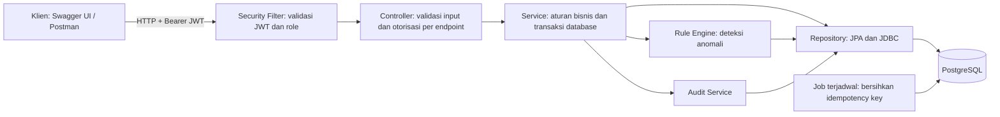
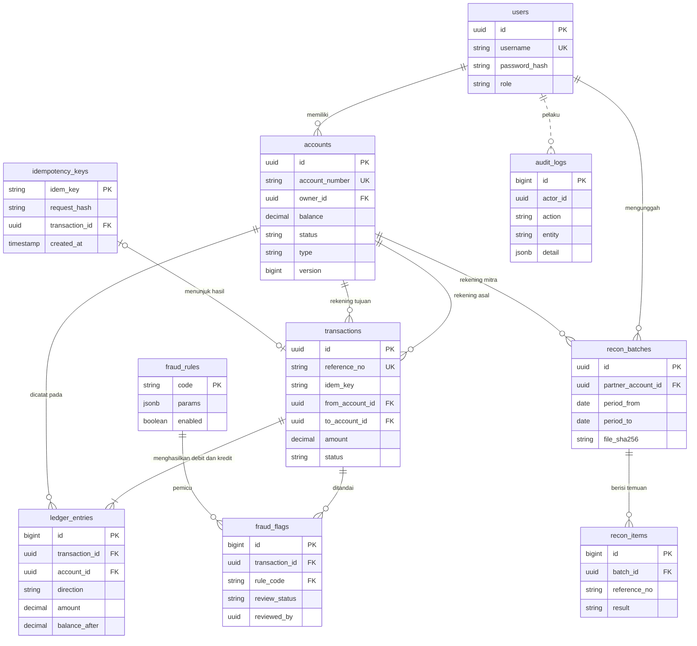
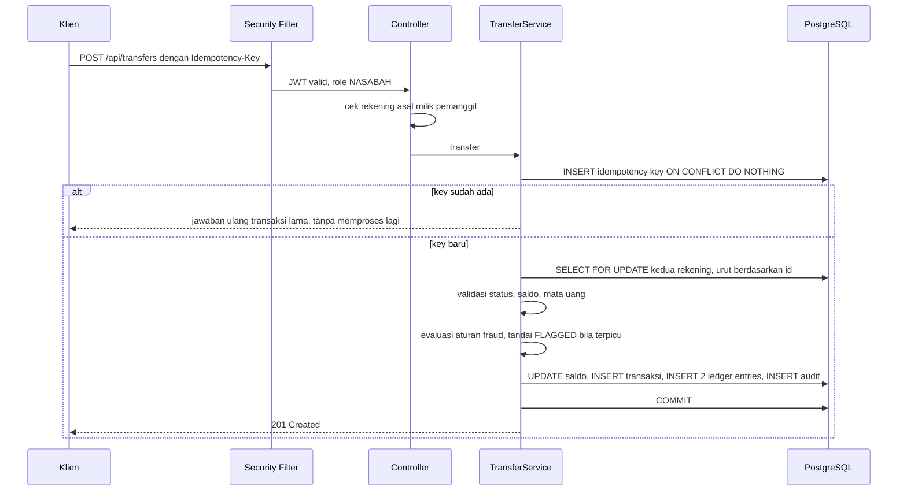

# Arsitektur CERMAT

Dokumen ini menjelaskan struktur, model data, dan alur utama CERMAT. Diagram memakai Mermaid, sehingga tampil langsung di GitHub.

## 1. Gambaran komponen

Paket kode (`id.cermat`):

| Paket | Tanggung jawab |
|---|---|
| `user`, `security` | Registrasi, login, JWT, role, pembatas login |
| `account` | Rekening, kepemilikan, pembekuan |
| `transaction` | Transfer, setoran, kas sistem (shard), idempotency |
| `ledger` | Entri debit/kredit append-only dan mutasi |
| `idempotency` | Klaim key atomik, kedaluwarsa |
| `rule` | Aturan deteksi, flag fraud, tinjauan operator |
| `recon` | Rekonsiliasi file mitra |
| `audit` | Jejak audit append-only |
| `common` | Penanganan error terpusat, konfigurasi |

## 2. Model data (ERD)

Catatan: `audit_logs.actor_id` sengaja tanpa foreign key agar jejak audit tidak pernah terblokir atau ikut terhapus oleh perubahan pada tabel lain.

## 3. Alur transfer

Semua langkah setelah klaim key berada dalam **satu transaksi database**. Jika ada yang gagal, seluruhnya dibatalkan, termasuk key dan jejak audit.

## 4. Invarian yang dijaga (dan dibuktikan test)

1. Total debit sama dengan total kredit di seluruh ledger.
2. Jumlah seluruh saldo (termasuk kas sistem) selalu 0: uang tidak tercipta atau hilang.
3. Saldo tiap rekening sama dengan hasil menjumlahkan ulang ledger-nya.
4. Saldo nasabah tidak pernah negatif, bahkan di bawah 150 transfer bersamaan.
5. Satu Idempotency-Key hanya pernah menghasilkan satu transaksi, bahkan jika dikirim 20 kali bersamaan.
6. Ledger dan audit log tidak dapat diubah atau dihapus (trigger database).

## 5. Pengendalian konkurensi

| Masalah | Mekanisme |
|---|---|
| Dua transfer dari rekening yang sama | Kunci baris `SELECT ... FOR UPDATE` (pessimistic) |
| Deadlock A→B dan B→A | Kunci selalu diambil berurutan berdasarkan id |
| Request ganda | `INSERT ... ON CONFLICT DO NOTHING` pada idempotency key |
| Update basi sebagai jaring pengaman | Kolom `version` (optimistic locking) |
| Hot row kas sistem | 16 shard kas, dipilih dari hash idempotency key |
| Dua operator meninjau flag yang sama | `UPDATE ... WHERE review_status = 'PENDING'` (atomik) |

## 6. Peta keamanan

| Risiko | Penanganan |
|---|---|
| Akses tanpa login | Default seluruh API tertutup, hanya `/api/auth/**` dan dokumentasi yang terbuka |
| IDOR/BOLA | Nasabah yang meminta rekening orang lain mendapat 404 (keberadaan tidak bocor) |
| Mass assignment | Pendaftaran mandiri tidak menerima field `role` |
| Eskalasi hak | `@PreAuthorize` per endpoint; operator tidak bisa memindahkan uang nasabah |
| Brute force login | Pembatas dua lapis (user+IP, IP), BCrypt, pesan error seragam |
| Token dirusak | HS256, validasi `exp` dan `issuer` |
| CSV/formula injection | Whitelist ketat pada `reference_no` dan `amount` |
| Unggahan berbahaya | Batas 2 MB dan 20.000 baris, ekstensi `.csv`, tidak ditulis ke disk |
| Penyangkalan | Audit log append-only (sukses maupun penolakan) |

## 7. Catatan keputusan desain

| Keputusan | Alternatif | Alasan |
|---|---|---|
| `NUMERIC` untuk uang | `double` | Floating point menimbulkan selisih pembulatan |
| Ledger append-only; koreksi lewat entri pembalik | Update/delete baris | Jejak yang tidak bisa dimanipulasi |
| Pessimistic lock | Optimistic saja | Pada rekening ramai, optimistic menghasilkan banyak kegagalan dan retry |
| Opsi A: tandai, bukan tahan | Opsi B: tahan sampai disetujui | Lebih sederhana dan sesuai post-transaction monitoring; Opsi B ada di roadmap |
| Status `FLAGGED` disembunyikan dari klien | Tampilkan | Memberi tahu pelaku bahwa ia terdeteksi hanya membantunya menghindar |
| JDBC untuk kolom JSONB dan laporan | JPA | Kontrol penuh atas tipe JSONB dan query agregat |
| Pembatas login di memori | Redis | Cukup untuk satu instance; keterbatasan dicatat |
